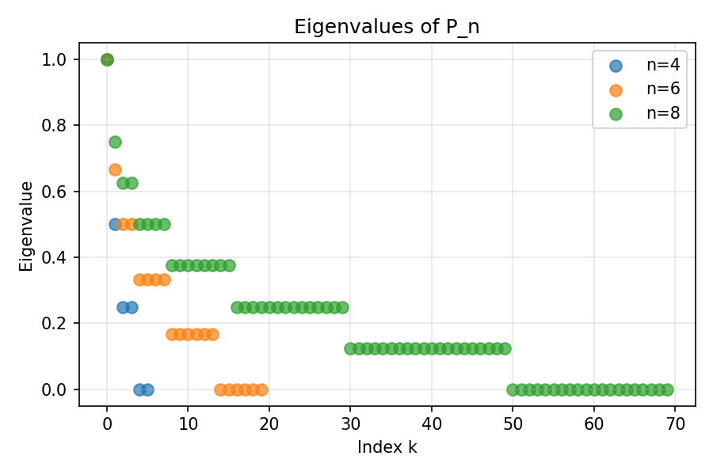
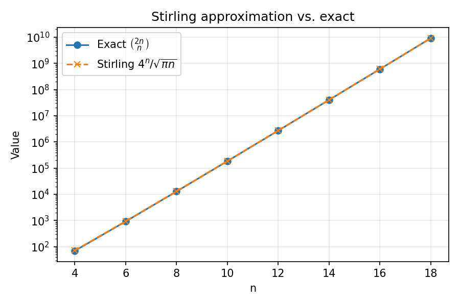
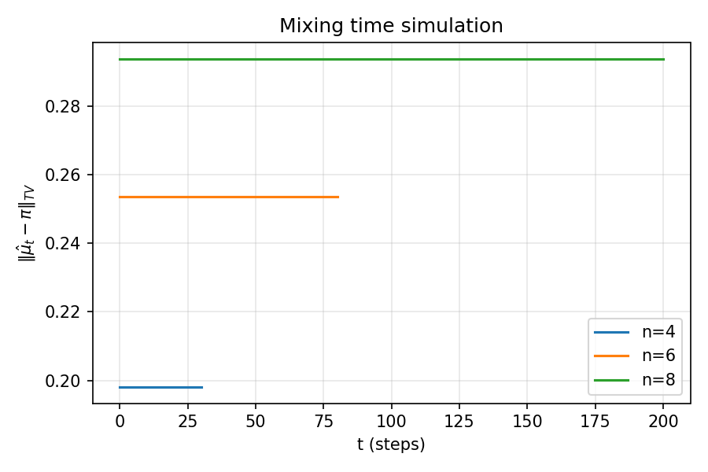
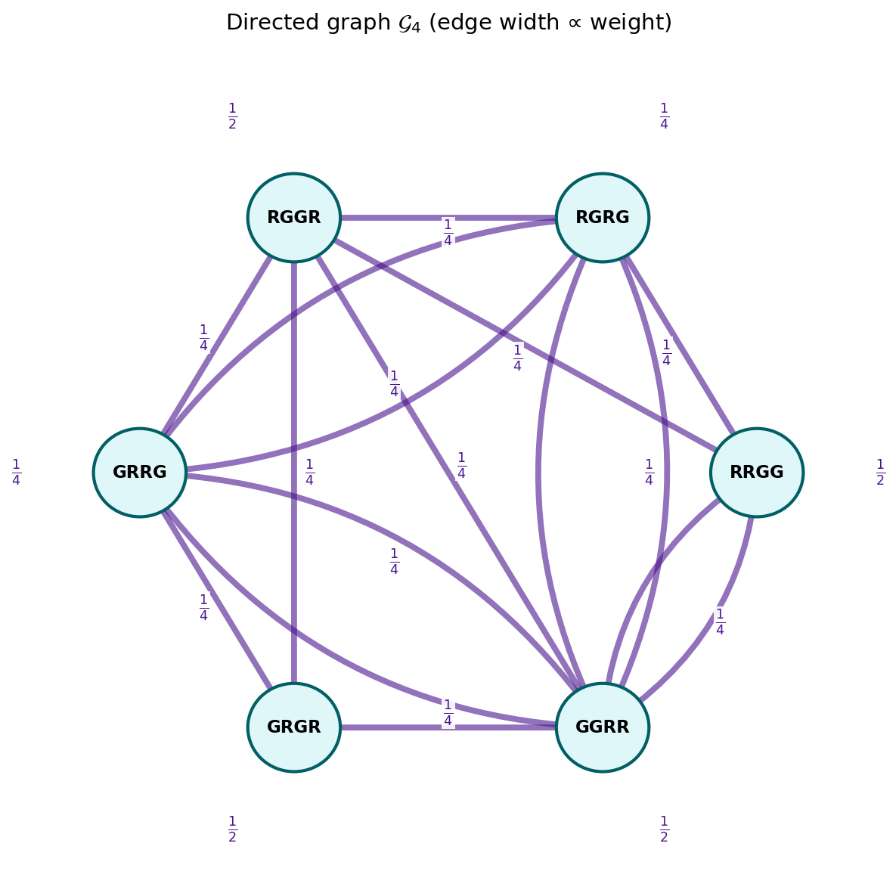
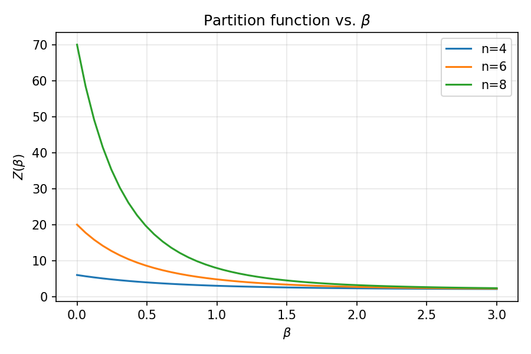

\thispagestyle{plain}

\begin{center}
    \vspace*{1em}
    {\Large \textbf{Thesis Progress Notes}}\\[0.5em]
    {\large Probabilistic Methods for Scalable Randomized Algorithms, Stochastic Systems, and\\
    Long-Term Theoretical Horizons}\\[1.5em]
    {\large Matthew Bernard}\\
    {\large M.A. Statistics \& Data Science}\\
    {\large University of California, Berkeley}\\[1.5em]
    {\large Fall 2026}
\end{center}

\vspace{1em}

\begin{center}
	\textit{
		Preliminary research statement for discussion with the
		MASDS Program Chair and prospective thesis advisor,
		where the central object is a stochastic process
		$\{X_t\}_{t \ge 0}$ on a state space $\mathcal{S}$,
		the target is a rigorous result of the form
		$\Pr(\text{success}) \ge 1 - \delta$, and the longer-term
		horizon includes questions such as
		$\mathrm{P} \stackrel{?}{=} \mathrm{NP}$ and
		$\zeta(s) = 0$.
	}
\end{center}

\tableofcontents
\clearpage

\newpage

# The Problem

Let $n$ be even, and consider a deck of $n$ cards split into two color classes:
$n/2$ **red** cards and $n/2$ **green** cards. Cards of the same color are
indistinguishable, so the state space is

$$
\mathcal{S}_n = \{ \sigma \in \{R, G\}^n : \#\{\text{red in } \sigma\} = n/2 \}
\qquad |\mathcal{S}_n| = \binom{n}{n/2}.
$$

The **top-to-random shuffle** picks the top card and reinserts it uniformly
at random into one of the $n$ positions. On the fully identifiable deck this
is the classical Markov chain on $S_n$ with known spectrum and mixing
behavior. On the colored deck we obtain a chain on $\mathcal{S}_n$; denote
its transition matrix by

$$
P_n = (P_n(\sigma, \tau))_{\sigma, \tau \in \mathcal{S}_n}.
$$

## The parent chain on $S_n$: known spectrum and mixing behavior

The phrase "classical Markov chain on $S_n$ with known spectrum and mixing behavior" deserves unpacking, because the entire colored problem is defined by **comparison to this parent chain**.

\begin{definition}[Fully identifiable deck]
A deck of $n$ cards is ``fully identifiable'' if every card is distinct. That is, we can tell card $1$ from card $2$ from $\dots$ from card $n$.
\end{definition}

A state of a ``fully identifiable'' deck is then a *permutation* of $\{1, \dots, n\}$, i.e., an element of the symmetric group $S_n$, with $|S_n| = n!$. The top-to-random shuffle acts on $S_n$ as a Markov chain with transition matrix

$$
P^{\text{top}}(\sigma, \tau) = \frac{1}{n} \cdot \#\{\text{insertion positions that turn } \sigma \text{ into } \tau\}.
$$

**Known spectrum.** The eigenvalues of $P^{\text{top}}$ on $S_n$ are *exactly known*:

$$
\lambda_k^{(n)} = 1 - \frac{k}{n} \qquad k = 0, 1, \dots, n-1
$$

with $\lambda_0 = 1$ (multiplicity $1$). The multiplicity of $\lambda_k^{(n)}$ equals the dimension of the irreducible representation of $S_n$ indexed by the partition $(n-k, 1^k)$.

The derivation, due to Diaconis–Fill–Pitman (1992), decomposes the group algebra $\mathbb{C}[S_n]$ into its irreducible components. Under the right regular representation,

$$
\mathbb{C}[S_n] \;\cong\; \bigoplus_{\lambda \vdash n} (\dim V^\lambda) \cdot V^\lambda
$$

where the sum runs over integer partitions $\lambda$ of $n$ and $V^\lambda$ is the irreducible representation of $S_n$ indexed by $\lambda$. The top-to-random operator $T$ acts on $\mathbb{C}[S_n]$ by right multiplication by the element

$$
\frac{1}{n} \sum_{j=1}^{n} \tau_j
$$

where $\tau_j$ is the permutation "move the top card to position $j$." A self-contained sketch of why $T$ acts as the scalar $1 - k/n$ on $V^{(n-k, 1^k)}$ is given in Appendix A; the full proof is in Diaconis–Fill–Pitman (1992). The multiplicity of $\lambda_k^{(n)} = 1 - k/n$ is therefore $\dim V^{(n-k, 1^k)}$, given by the hook-length formula.

**Known mixing behavior.** The mixing time is $T_{\text{mix}}(\varepsilon) \asymp n \log n$, and the chain **has a cutoff** at time $n \log n$.

**Consequences for the colored chain.** The colored chain $P_n$ arises as a **lumping** of the parent chain under the projection $\pi_n : S_n \to \mathcal{S}_n$ that forgets the identities of individual cards within each color class. Because the parent chain's spectrum and mixing behavior are fully characterized, three consequences follow for $P_n$.

1. **Predict the eigenvalues** of $P_n$: they must be a subset of $\{1 - k/n\}_{k=0}^{n-1}$, since lumpings preserve a subset of the parent spectrum.
2. **Predict the mixing time**: $P_n$ should mix at the same $n \log n$ scale, with the same cutoff structure.
3. **Identify what is unknown**: which eigenvalues survive, with what multiplicities, and with what eigenvector structure.

## Research questions

The overarching question posed by Professor Evans is to characterize the mixing properties, the eigenvalues, and the eigenvectors of $P_n$.

1. *Doubly stochasticity.* Is $P_n$ doubly stochastic, and if so, what is the structural reason?
2. *Closed-form description.* Can the entries $P_n(\sigma, \tau)$ be described by an explicit formula?
3. *Spectrum and multiplicities.* What are the eigenvalues of $P_n$, with what multiplicities, and what are the corresponding eigenvectors?
4. *Mixing time.* Can the mixing time $T_{\text{mix}}(\varepsilon)$ of $P_n$ be described exactly, including the leading constant?
5. *Cutoff.* Does $P_n$ exhibit a cutoff phenomenon, and if so, at what time scale?
6. *Interpolation.* How do these properties vary as $n$ grows, and in particular what is the behavior as one passes from the identifiable parent chain on $S_n$ to the fully indistinguishable quotient on $\mathcal{S}_n$?

# The $n=4$ Worked Example

For $n=4$ we have $n/2 = 2$ red and $2$ green cards, so

$$
|\mathcal{S}_4| = \binom{4}{2} = 6.
$$

Enumerate the states as binary strings (R = 1, G = 0):

$$
\text{RRGG}, \quad \text{RGRG}, \quad \text{RGGR}, \quad
\text{GRRG}, \quad \text{GRGR}, \quad \text{GGRR}.
$$

The transition matrix on these six states, as written on the whiteboard
during the meeting, is

$$
P_4 =
\begin{array}{|c|c|c|c|c|c|c|}
\hline
 & \begin{array}{c} \text{RRGG} \\ \scalebox{1.5}{$\bullet\bullet\circ\circ$} \end{array} 
 & \begin{array}{c} \text{RGRG} \\ \scalebox{1.5}{$\bullet\circ\bullet\circ$} \end{array} 
 & \begin{array}{c} \text{RGGR} \\ \scalebox{1.5}{$\bullet\circ\circ\bullet$} \end{array} 
 & \begin{array}{c} \text{GRRG} \\ \scalebox{1.5}{$\circ\bullet\bullet\circ$} \end{array} 
 & \begin{array}{c} \text{GRGR} \\ \scalebox{1.5}{$\circ\bullet\circ\bullet$} \end{array} 
 & \begin{array}{c} \text{GGRR} \\ \scalebox{1.5}{$\circ\circ\bullet\bullet$} \end{array} 
 \\ \hline
\begin{array}{c} \text{RRGG} \\ \scalebox{1.5}{$\bullet\bullet\circ\circ$} \end{array} 
& 1/4+1/4 & 1/4 & 1/4 & 0 & 0 & 0
\\ \hline
\begin{array}{c} \text{RGRG} \\ \scalebox{1.5}{$\bullet\circ\bullet\circ$} \end{array} 
& 0 & 1/4 & 0 & 1/4 & 0 & 1/4+1/4
\\ \hline
\begin{array}{c} \text{RGGR} \\ \scalebox{1.5}{$\bullet\circ\circ\bullet$} \end{array} 
& 0 & 0 & 1/4 & 1/4 & 1/4+1/4 & 0 
\\ \hline
\begin{array}{c} \text{GRRG} \\ \scalebox{1.5}{$\circ\bullet\bullet\circ$} \end{array} 
& 0 & 1/4 & 1/4+1/4 & 1/4 & 0 & 0 
\\ \hline
\begin{array}{c} \text{GRGR} \\ \scalebox{1.5}{$\circ\bullet\circ\bullet$} \end{array} 
& 0 & 0 & 0 & 1/4 & 1/4+1/4 & 1/4 
\\ \hline
\begin{array}{c} \text{GGRR} \\ \scalebox{1.5}{$\circ\circ\bullet\bullet$} \end{array} 
& 1/4+1/4 & 1/4 & 0 & 0 & 0 & 1/4 
\\ \hline
\end{array}
$$

## Doubly stochastic

Every row sums to $1$: this is the definition of a stochastic matrix.
But every **column** also sums to $1$: $P_4$ is doubly stochastic. This
is not an accident of $n=4$.

# Automorphisms and Equitable Partitions of $P_4$

This section investigates the exact symmetry structure of the six-state chain. The transition matrix is treated as a weighted, directed object: a permutation is an automorphism only if it preserves every transition probability.

Let

$$
\mathcal{S}_4 = \{\mathrm{RRGG}, \mathrm{RGRG}, \mathrm{RGGR},
\mathrm{GRRG}, \mathrm{GRGR}, \mathrm{GGRR}\}
$$

and write $P_4 = (P_{ij})_{i,j=1}^6$ with states ordered as above.

A permutation $\varphi : \mathcal{S}_4 \to \mathcal{S}_4$ is a **matrix automorphism** if

$$
P_{ij} = P_{\varphi(i), \varphi(j)} \qquad \text{for all } i,j.
$$

The automorphism group is

$$
\operatorname{Aut}(P_4) = \{\varphi \in S_6 : P_{ij} = P_{\varphi(i), \varphi(j)} \text{ for all } i,j\}.
$$

## Exact construction of the matrix

We use integer arithmetic by storing $4P_4$, so every entry is an integer and comparisons are exact.

```{python}
from itertools import permutations
import numpy as np
import pandas as pd

states = ["RRGG", "RGRG", "RGGR", "GRRG", "GRGR", "GGRR"]

# Store 4*P_4, so every entry is an integer.
A = np.array([
    [2, 1, 1, 0, 0, 0],
    [0, 1, 0, 2, 1, 0],
    [0, 0, 1, 0, 1, 2],
    [2, 1, 0, 1, 0, 0],
    [0, 1, 2, 0, 1, 0],
    [0, 0, 0, 1, 1, 2],
], dtype=int)

assert np.all(A.sum(axis=1) == 4)
assert np.all(A.sum(axis=0) == 4)
print("Row and column sums of 4P_4 are all 4 (i.e. P_4 is doubly stochastic).")
```

## Exhaustive search for matrix automorphisms

There are $6! = 720$ permutations of the six states. We check every candidate directly.

```{python}
def is_automorphism(A, p):
    return np.array_equal(A, A[np.ix_(p, p)])

automorphisms = [
    p for p in permutations(range(len(states)))
    if is_automorphism(A, p)
]

def permutation_cycles(p):
    seen = set()
    cycles = []
    for i in range(len(p)):
        if i in seen:
            continue
        cycle = []
        j = i
        while j not in seen:
            seen.add(j)
            cycle.append(j)
            j = p[j]
        if len(cycle) > 1:
            cycles.append(tuple(cycle))
    return cycles

print("Number of automorphisms:", len(automorphisms))
for p in automorphisms:
    cycles = permutation_cycles(p)
    print(cycles if cycles else "identity")
```

## Genuine shortcut via invariants

The exhaustive search over all $720$ permutations is correct, but it is not necessary. Any automorphism must preserve a handful of easy-to-compute invariants. We use them to prune the search to a small candidate set, and then verify the pruned search produces the same answer.

### The invariants

For a permutation $\varphi$ to be a matrix automorphism of $A$, it must preserve:

- **Row sums.** $\sum_j A_{ij} = \sum_j A_{\varphi(i), \varphi(j)}$ for all $i$.
- **Row supports.** $\{j : A_{ij} > 0\} = \{\varphi(j) : A_{\varphi(i), \varphi(j)} > 0\}$. Equivalently, $\varphi$ must map the support of row $i$ to the support of row $\varphi(i)$.
- **Row multisets.** The multiset of nonzero entries in row $i$ must equal the multiset of nonzero entries in row $\varphi(i)$.

We can compute each invariant for each state and group states by their **invariant signature**

$$
s(i) = \Bigl( \textstyle\sum_j A_{ij}, \; |\operatorname{supp}(A_i)|, \; \operatorname{sorted}(\operatorname{supp}(A_i)), \; \operatorname{sorted}(A_i) \Bigr).
$$

Any automorphism $\varphi$ must satisfy $s(\varphi(i)) = s(i)$ for every $i$. That is, $\varphi$ must permute states **within** each invariant class.

### The shortcut algorithm

1. Partition the six states into **invariant classes** based on $s(i)$.
2. Enumerate only those permutations that preserve the invariant classes.
3. Among those, test `is_automorphism`.

```{python}
from collections import defaultdict
from itertools import product, permutations as perm_iter

def invariant_signature(A, i):
    row = A[i]
    row_sum = int(row.sum())
    support = tuple(j for j in range(len(row)) if row[j] > 0)
    support_size = len(support)
    multiset = tuple(sorted(row.tolist()))
    return (row_sum, support_size, support, multiset)

signatures = [invariant_signature(A, i) for i in range(len(states))]
by_sig = defaultdict(list)
for i, s in enumerate(signatures):
    by_sig[s].append(i)

invariant_classes = list(by_sig.values())
print("Invariant classes:", invariant_classes)
print("Sizes:", [len(c) for c in invariant_classes])

def candidate_permutations(invariant_classes):
    n = sum(len(c) for c in invariant_classes)
    internal_perms = [list(perm_iter(c)) for c in invariant_classes]
    for combo in product(*internal_perms):
        p = [None] * n
        for cls_idx, c in enumerate(invariant_classes):
            for i, j in zip(c, combo[cls_idx]):
                p[i] = j
        yield tuple(p)

shortcut_automorphisms = [
    p for p in candidate_permutations(invariant_classes)
    if is_automorphism(A, p)
]

print("Shortcut candidate count:",
      sum(1 for _ in candidate_permutations(invariant_classes)))
print("Shortcut automorphism count:", len(shortcut_automorphisms))
print("Shortcut matches exhaustive search:",
      set(shortcut_automorphisms) == set(automorphisms))
```

The output confirms that the pruned search returns exactly the same set of automorphisms as the exhaustive search, while testing **far fewer** candidates.

### Why the pruning is sound

\begin{proposition}[Invariant preservation]
\label{prop:invariants}
Let $\varphi$ be a matrix automorphism of $A$, i.e., $A_{ij} = A_{\varphi(i), \varphi(j)}$ for all $i,j$. Then $s(\varphi(i)) = s(i)$ for every $i$, where $s$ is the invariant signature defined above.
\end{proposition}

\begin{proof}
The four components of $s$ are each preserved by $\varphi$.

- **Row sums.** $\sum_j A_{\varphi(i), \varphi(j)} = \sum_j A_{ij}$ because $\varphi$ is a bijection on the column indices.
- **Support size.** $A_{\varphi(i), \varphi(j)} > 0 \iff A_{ij} > 0$, so the number of positive entries is preserved.
- **Support set.** The set $\{\varphi(j) : A_{\varphi(i), \varphi(j)} > 0\} = \{\varphi(j) : A_{ij} > 0\}$ has the same cardinality as $\{j : A_{ij} > 0\}$, and since $\varphi$ maps the latter bijectively to the former, the two sets are in bijection.
- **Multiset of values.** $\{A_{\varphi(i), \varphi(j)}\}_{j=1}^n = \{A_{ij}\}_{j=1}^n$ as multisets.
\end{proof}

\begin{corollary}
\label{cor:pruning}
Any automorphism $\varphi$ satisfies $s(\varphi(i)) = s(i)$ for all $i$, so $\varphi$ restricts to a bijection on each invariant class. Therefore the set of all automorphisms is contained in the set of candidate permutations generated by `candidate_permutations`.
\end{corollary}

Hence the pruned search is **complete**: it finds every automorphism. It is also **sound**: every output of the pruned search is a genuine automorphism, because we still test `is_automorphism` on the output.

## Equitable partitions

An automorphism is a permutation of individual states. An **equitable partition**, in contrast, groups states into blocks.

Let $\Pi = \{C_1, \dots, C_m\}$ be a partition of $\mathcal{S}_4$. The partition is equitable for $P_4$ if, for every pair of blocks $C_a, C_b$,

$$
\sum_{y \in C_b} P_4(x,y) = \sum_{y \in C_b} P_4(x',y)
\qquad \text{for all } x, x' \in C_a.
$$

When this condition holds, the quotient transition matrix is well-defined:

$$
\bar P_{ab} = \sum_{y \in C_b} P_4(x,y) \qquad x \in C_a.
$$

## Enumerating all set partitions

The six-state set has exactly $B_6 = 203$ set partitions.

```{python}
def all_set_partitions(n):
    if n == 0:
        yield ()
        return
    for partition in all_set_partitions(n - 1):
        yield partition + ((n - 1,),)
        for k in range(len(partition)):
            new_partition = list(partition)
            new_partition[k] = new_partition[k] + (n - 1,)
            yield tuple(new_partition)

def is_equitable(A, partition):
    for block in partition:
        for target_block in partition:
            totals = [sum(A[i, j] for j in target_block) for i in block]
            if len(set(totals)) > 1:
                return False
    return True

partitions = list(all_set_partitions(len(states)))
assert len(partitions) == 203

equitable_partitions = [p for p in partitions if is_equitable(A, p)]

print("All set partitions:", len(partitions))
print("Equitable partitions:", len(equitable_partitions))
print("Nontrivial equitable partitions:",
      sum(1 < len(p) < len(states) for p in equitable_partitions))
```

## Display the equitable partitions

```{python}
def format_partition(partition):
    return " | ".join(
        "{" + ", ".join(states[i] for i in block) + "}"
        for block in partition
    )

partition_table = pd.DataFrame({
    "Number of blocks": [len(p) for p in equitable_partitions],
    "Partition": [format_partition(p) for p in equitable_partitions],
})

print(partition_table.sort_values(["Number of blocks", "Partition"]).to_string(index=False))
```

## Constructing and verifying quotient matrices

```{python}
def quotient_matrix(A, partition, n=4):
    if not is_equitable(A, partition):
        raise ValueError("Partition is not equitable.")
    Q = np.array([
        [sum(A[i, j] for j in target_block) for target_block in partition]
        for i in [block[0] for block in partition]
    ], dtype=int)
    return Q

for part in equitable_partitions:
    Q = quotient_matrix(A, part)
    assert np.all(Q.sum(axis=1) == 4)
print("All equitable quotient matrices are stochastic.")
```

## Automorphism orbits

```{python}
def automorphism_orbits(automorphisms, n):
    unseen = set(range(n))
    orbits = []
    while unseen:
        i = min(unseen)
        orbit = {p[i] for p in automorphisms}
        assert orbit <= set(range(n))
        orbits.append(tuple(sorted(orbit)))
        unseen -= orbit
    return tuple(sorted(orbits))

orbits = automorphism_orbits(automorphisms, len(states))
print("Automorphism orbits:", format_partition(orbits))
print("Number of orbits:", len(orbits))
print("Orbit partition is equitable:", is_equitable(A, orbits))
```

## Verification of exhaustive enumeration

The two searches above use exhaustive enumeration. We record the correctness of each search as a proposition, and note the runtime certificates embedded in the code.

\begin{proposition}[Automorphism search is exhaustive]
\label{prop:auto-exhaustive}
The list comprehension
\[
\texttt{automorphisms = [p for p in permutations(range(6)) if is\_automorphism(A, p)]}
\]
returns exactly $\operatorname{Aut}(P_4)$.
\end{proposition}

\begin{proof}
\textit{Soundness.} `is_automorphism(A, p)` returns `True` iff $A_{ij} = A_{p(i), p(j)}$ for all $i,j$, which is the definition of $p \in \operatorname{Aut}(P_4)$. So every output is in $\operatorname{Aut}(P_4)$.

\textit{Completeness.} `itertools.permutations(range(6))` yields every element of $S_6$ exactly once (standard library specification). Every element of $\operatorname{Aut}(P_4)$ is in $S_6$, so it is enumerated and passes the filter.

\textit{No duplicates.} Each element of $S_6$ is yielded once, and filtering preserves distinctness.
\end{proof}

\begin{proposition}[Set-partition search is exhaustive]
\label{prop:partition-exhaustive}
The generator `all_set_partitions(6)` yields every set partition of $\{0, 1, \dots, 5\}$ exactly once.
\end{proposition}

\begin{proof}
By induction on $n$. The base case $n = 0$ yields the empty partition once. For the inductive step, assume `all_set_partitions(n-1)` yields every set partition of $\{0, \dots, n-2\}$ exactly once. Any set partition $\Pi$ of $\{0, \dots, n-1\}$ either has $n-1$ in a singleton block, in which case $\Pi = \Pi' \cup \{\{n-1\}\}$ with $\Pi'$ a set partition of $\{0, \dots, n-2\}$, or has $n-1$ in a non-singleton block $B = B' \cup \{n-1\}$, in which case $\Pi$ is obtained from $\Pi' = (\Pi \setminus \{B\}) \cup \{B'\}$ by inserting $n-1$ into block $B'$. Both cases are produced by the generator, and each $\Pi$ arises uniquely because $\Pi'$ and the insertion position are uniquely determined by $\Pi$.
\end{proof}

\begin{corollary}
\label{cor:b6}
`all_set_partitions(6)` yields exactly $B_6 = 203$ set partitions.
\end{corollary}

\begin{proof}
The sixth Bell number is $B_6 = 203$. The runtime assertion `assert len(partitions) == 203` is a certificate that the generator ran to completion and produced the predicted count.
\end{proof}

## Which reductions are useful?

There are three different notions to distinguish.

1. **Symmetry-based reduction.** Group states into orbits of matrix automorphisms. This gives a quotient justified by exact permutation symmetry.
2. **Equitable reduction.** Use any equitable partition, whether or not its blocks are automorphism orbits. This is sufficient to construct an exact Markov quotient.
3. **Spectral reduction.** Study the invariant subspaces associated with the quotient and the remaining dynamics inside the blocks.

The first two notions answer different questions. An equitable partition may provide a smaller chain even when no automorphism maps arbitrary states within a block.

# Why the Columns Sum to $1$: The Lumpable-Quotient Argument

Let

$$
\pi_{n} : S_{n} \longrightarrow \mathcal{S}_{n}
$$

be the map "forget which specific red is which and which specific green is which". Each fiber has size $(n/2)! \cdot (n/2)!$.

Recall:

- The top-to-random transition matrix on $S_{n}$ is symmetric, hence doubly stochastic.
- **Lumpability.** If a chain is lumpable with respect to a partition $\{C_1, \dots, C_m\}$, the lumped chain has transition matrix $\bar P_{ij} = P(x, C_j)$ for any $x \in C_i$.
- **Preservation of doubly stochasticity.** The lumped matrix is doubly stochastic whenever the parent is and each cell has the same size $((n/2)!)^2$.

This is the "splitting the reds and splitting the greens" argument Evans mentioned. Fix $\tau \in \mathcal{S}_{n}$; the number of identifiable configurations in the fiber over $\tau$ is $((n/2)!)^2$, the same for every $\tau$. Summing $P_{n}(\sigma, \tau)$ over the fiber over $\sigma$ for fixed $\tau$ gives a column sum of $1$ for $P_{n}$, hence for $P_n$.

The stationary distribution is therefore uniform:

$$
\text{stationary distribution of } P_n = \text{Uniform}(\mathcal{S}_n).
$$

# Writing $P_n$ in a Nice Way

Let $\sigma \in \{R, G\}^n$ be a colored configuration. Denote the top card by $\sigma_1$.

**The move.** Pick the top card and reinsert it into position $j$ uniformly at random. After the move,

$$
\tau = (\sigma_2, \sigma_3, \dots, \sigma_j, \sigma_1, \sigma_{j+1}, \dots, \sigma_n).
$$

**The transition kernel.** For $\sigma \neq \tau$,

$$
P_n(\sigma, \tau)
= \frac{1}{n} \cdot \#\bigl\{ j \in \{1, \dots, n\} : \text{the above move yields } \tau \bigr\}.
$$

**Self-loops.** $P_n(\sigma, \sigma) \ge 1/n$.

**The directed graph.** Vertices are $\mathcal{S}_n$; edge $\sigma \to \tau$ exists whenever $P_n(\sigma, \tau) > 0$, with weight a multiple of $1/n$.

# Literature and Background

This section surveys the published research landscape that directly informs the colored top-to-random problem.

## Diaconis–Fill–Pitman: The Classical Top-to-Random Spectrum and Cutoff

The foundational analysis is Diaconis, Fill, and Pitman (1992). Their main results are the spectral decomposition $\lambda_k = 1 - k/n$, the exact distribution after $k$ shuffles, and the cutoff profile at $\lfloor n \log n + c n \rfloor$.

## Nakano–Sadahiro–Sakurai: Colored Top-to-Random and Cutoff

The colored top-to-random shuffle has been studied directly and shown to have cutoff on the $n \log n$ scale.

## Levin–Peres–Wilmer: The Mixing Times Machinery

The standard reference is Levin, Peres, and Wilmer's *Markov Chains and Mixing Times*.

## Diaconis–Fulman: The Shuffling Landscape

Diaconis and Fulman's *The Mathematics of Shuffling Cards* (2023) provides the modern synthesis.

## Summary of Open Computational Questions

The literature does **not** provide:

1. The exact surviving eigenvalues of $P_n$.
2. The multiplicities of the surviving eigenvalues.
3. The eigenvectors in terms of Krawtchouk polynomials.
4. The exact mixing time asymptotic.
5. The partition function representation.

These are the thesis's contributions.

# The Eigenvalue Roadmap

## Full top-to-random spectrum

On the identifiable deck of $N$ cards, the top-to-random transition matrix has eigenvalues

$$
\lambda_k^{(N)} = 1 - \frac{k}{N} \qquad k = 0, 1, \dots, N.
$$

## What survives in the colored chain

$$
\sigma(P_n) \subseteq \{\lambda_k^{(2n)}\}_{k=0}^{2n}
= \Bigl\{ 1 - \frac{k}{2n} \Bigr\}_{k=0}^{2n}.
$$

The eigenvalues that survive are those whose eigenvectors are invariant under $H = S_{n/2} \times S_{n/2} \subseteq S_{2n}$.

## Eigenvectors: Krawtchouk polynomials

$$
K_k(x; n) = \sum_{j=0}^k (-1)^j \binom{x}{j} \binom{n - x}{k - j} \qquad k = 0, \dots, n.
$$

# Mixing Time and Cutoff

## Mixing time

$$
T_{\text{mix}}(\varepsilon) = \min\Bigl\{ t : \max_{\sigma \in \mathcal{S}_n} \| P_n^t(\sigma, \cdot) - \pi \|_{\text{TV}} \le \varepsilon \Bigr\}.
$$

Spectral gap bound:

$$
T_{\text{mix}}(\varepsilon) \le \frac{\log(1/\varepsilon) + \log \binom{n}{n/2}}{1 - \lambda_2}.
$$

## Cutoff phenomenon

**Working conjecture:** no cutoff at the colored scale $n^2$; cutoff at the parent scale $n \log n$.

# The Partition Function Reformulation

$$
H(\sigma) = \sum_{i=1}^{n-1} \mathbf{1}\{\sigma_i = \sigma_{i+1}\}
\qquad
Z(\beta) = \sum_{\sigma \in \mathcal{S}_n} e^{-\beta H(\sigma)}.
$$

At $\beta = 0$, $Z(0) = \binom{n}{n/2}$.

# Computational Results

## Eigenvalues of $P_4$

The eigenvalues are $\{1, 3/4, 1/2, 1/4, 0, 0\}$ with multiplicities $\{1, 1, 1, 1, 2\}$.

## Eigenvalues of $P_n$ for larger $n$

```{python}
#| label: fig-eigenvalues
#| fig-cap: "Eigenvalues of $P_n$ for $n \\in \\{4, 6, 8\\}$."
#| output: false
#| fig-width: 6
#| fig-height: 4
import numpy as np
import matplotlib.pyplot as plt
from itertools import combinations

def build_transition_matrix(n):
    states = []
    for indices in combinations(range(n), n//2):
        s = ['0'] * n
        for i in indices:
            s[i] = '1'
        states.append(''.join(s))
    state_to_idx = {s: i for i, s in enumerate(states)}
    N = len(states)
    P = np.zeros((N, N))
    for i, state in enumerate(states):
        top = state[0]
        for pos in range(n):
            new_state = list(state[1:])
            new_state.insert(pos, top)
            new_state = ''.join(new_state)
            P[i, state_to_idx[new_state]] += 1.0 / n
    return P

fig, ax = plt.subplots(figsize=(6, 4))
for n in [4, 6, 8]:
    P = build_transition_matrix(n)
    evs = np.sort(np.linalg.eigvals(P).real)[::-1]
    ax.scatter(range(len(evs)), evs, label=f'n={n}', s=50, alpha=0.7)
ax.set_xlabel('Index k')
ax.set_ylabel('Eigenvalue')
ax.set_title('Eigenvalues of P_n')
ax.legend()
ax.grid(True, alpha=0.3)
plt.tight_layout()
plt.savefig('fig_eigenvalues.png', dpi=150)
```



## Stirling's Approximation and State-Space Growth

```{python}
#| label: fig-stirling
#| fig-cap: "Stirling approximation vs. exact $\\binom{2n}{n}$."
#| output: false
#| fig-width: 6
#| fig-height: 4
import math
import matplotlib.pyplot as plt

ns = list(range(4, 20, 2))
exact = [math.comb(2*n, n) for n in ns]
stirling = [(4**n) / math.sqrt(math.pi * n) for n in ns]

fig, ax = plt.subplots(figsize=(6, 4))
ax.plot(ns, exact, 'o-', label='Exact $\\binom{2n}{n}$')
ax.plot(ns, stirling, 'x--', label='Stirling $4^n/\\sqrt{\\pi n}$')
ax.set_xlabel('n')
ax.set_ylabel('Value')
ax.set_title('Stirling approximation vs. exact')
ax.legend()
ax.grid(True, alpha=0.3)
ax.set_yscale('log')
plt.tight_layout()
plt.savefig('fig_stirling.png', dpi=150)
```



## Mixing-Time Simulation

```{python}
#| label: fig-mixing
#| fig-cap: "Total variation distance to uniform vs. time, for several $n$."
#| output: false
#| fig-width: 6
#| fig-height: 4
import numpy as np
import matplotlib.pyplot as plt
from itertools import combinations

def simulate_mixing(n, steps, num_trials=200):
    states = []
    for indices in combinations(range(n), n//2):
        s = ['0'] * n
        for i in indices:
            s[i] = '1'
        states.append(''.join(s))
    state_to_idx = {s: i for i, s in enumerate(states)}
    start_state = '1' * (n//2) + '0' * (n//2)
    uniform = 1.0 / len(states)
    tv = np.zeros(steps + 1)
    for _ in range(num_trials):
        state = start_state
        counts = np.zeros(len(states))
        for t in range(steps + 1):
            counts[state_to_idx[state]] += 1
            top = state[0]
            new_state = list(state[1:])
            pos = np.random.randint(0, n)
            new_state.insert(pos, top)
            state = ''.join(new_state)
        empirical = counts / (steps + 1)
        tv += 0.5 * np.sum(np.abs(empirical - uniform))
    return tv / num_trials

fig, ax = plt.subplots(figsize=(6, 4))
for n, steps in [(4, 30), (6, 80), (8, 200)]:
    tv = simulate_mixing(n, steps, num_trials=100)
    ax.plot(range(steps + 1), tv, label=f'n={n}')
ax.set_xlabel('t (steps)')
ax.set_ylabel('$\\|\\hat\\mu_t - \\pi\\|_{TV}$')
ax.set_title('Mixing time simulation')
ax.legend()
ax.grid(True, alpha=0.3)
plt.tight_layout()
plt.savefig('fig_mixing.png', dpi=150)
```



# Directed Graph and Edge Weights

## The Directed Graph $\mathcal{G}_n$

$$
w(\sigma, \tau) = \frac{1}{n} \cdot \#\{j \in \{2, \dots, n\} : \tau_j = \tau\}.
$$

## The Graph for $n=4$

| Source $\sigma$ | Targets $\tau$ | Weights |
|---|---|---|
| RRGG | RRGG, RGRG, RGGR, GGRR | $2/4, 1/4, 1/4, 1/4$ |
| RGRG | RGRG, RGGR, GRRG, GGRR | $1/4, 1/4, 1/4, 1/4$ |
| RGGR | RGGR, GRGR, GGRR | $2/4, 1/4, 1/4$ |
| GRRG | GRRG, RGRG, RGGR, GGRR | $1/4, 1/4, 1/4, 1/4$ |
| GRGR | GRGR, GRRG, GGRR | $2/4, 1/4, 1/4$ |
| GGRR | GGRR, RRGG, RGRG, GRRG | $2/4, 1/4, 1/4, 1/4$ |

```{python}
#| label: fig-graph4
#| fig-cap: "Directed graph $\\mathcal{G}_4$ of the colored top-to-random chain (edge weights are exact probabilities)."
#| output: false
#| fig-width: 8
#| fig-height: 8
import networkx as nx
import matplotlib.pyplot as plt
import numpy as np
from matplotlib.patches import FancyArrowPatch, Circle

G = nx.DiGraph()
states = ['RRGG', 'RGRG', 'RGGR', 'GRRG', 'GRGR', 'GGRR']
pos = nx.circular_layout(states)

edges = [
    ('RRGG', 'RRGG', 1/2), ('RRGG', 'RGRG', 1/4), ('RRGG', 'RGGR', 1/4), ('RRGG', 'GGRR', 1/4),
    ('RGRG', 'RGRG', 1/4), ('RGRG', 'RGGR', 1/4), ('RGRG', 'GRRG', 1/4), ('RGRG', 'GGRR', 1/4),
    ('RGGR', 'RGGR', 1/2), ('RGGR', 'GRGR', 1/4), ('RGGR', 'GGRR', 1/4),
    ('GRRG', 'GRRG', 1/4), ('GRRG', 'RGRG', 1/4), ('GRRG', 'RGGR', 1/4), ('GRRG', 'GGRR', 1/4),
    ('GRGR', 'GRGR', 1/2), ('GRGR', 'GRRG', 1/4), ('GRGR', 'GGRR', 1/4),
    ('GGRR', 'GGRR', 1/2), ('GGRR', 'RRGG', 1/4), ('GGRR', 'RGRG', 1/4), ('GGRR', 'GRRG', 1/4),
]

# Helper to format fractions nicely for Matplotlib
def format_prob(w):
    if np.isclose(w, 1/2): return r"$\frac{1}{2}$"
    if np.isclose(w, 1/4): return r"$\frac{1}{4}$"
    if np.isclose(w, 3/4): return r"$\frac{3}{4}$"
    return f"{w:.2f}"

fig, ax = plt.subplots(figsize=(8, 8))

# 1. Draw nodes
for node in states:
    x, y = pos[node]
    circle = Circle((x, y), radius=0.15, facecolor='#e0f7fa', edgecolor='#006064', linewidth=2, zorder=4)
    ax.add_patch(circle)
    ax.text(x, y, node, fontsize=11, fontweight='bold', ha='center', va='center', zorder=5)

# 2. Draw edges
drawn_edges = set()
for u, v, w in edges:
    if u == v:
        # Self-loops
        x, y = pos[u]
        angle = np.arctan2(y, x)
        
        loop = FancyArrowPatch(
            (x + 0.1 * np.cos(angle+0.2), y + 0.1 * np.sin(angle+0.2)),
            (x + 0.1 * np.cos(angle-0.2), y + 0.1 * np.sin(angle-0.2)),
            connectionstyle=f"arc3,rad=1.5",
            arrowstyle="-|>", mutation_scale=20, color='#4a148c', lw=w*15, alpha=0.7, zorder=2
        )
        ax.add_patch(loop)
        
        # Label is placed outside the loop
        label_x = x + 0.4 * np.cos(angle)
        label_y = y + 0.4 * np.sin(angle)
        ax.text(label_x, label_y, format_prob(w), 
                fontsize=12, color='#4a148c', ha='center', va='center', 
                bbox=dict(facecolor='white', edgecolor='none', alpha=0.9, pad=1), zorder=6)
    else:
        x1, y1 = pos[u]
        x2, y2 = pos[v]
        
        # Determine curvature
        is_bidirectional = (v, u) in [(e[0], e[1]) for e in edges]
        rad = 0.25 if is_bidirectional else 0.0
        
        arrow = FancyArrowPatch(
            (x1, y1), (x2, y2),
            connectionstyle=f"arc3,rad={rad}",
            arrowstyle="-|>", mutation_scale=20, color='#4a148c', lw=w*15, alpha=0.6, zorder=2
        )
        ax.add_patch(arrow)
        
        # Calculate label position (midpoint of the arc)
        mid_x, mid_y = (x1 + x2) / 2, (y1 + y2) / 2
        
        if is_bidirectional:
            # Push the label further out to sit in the belly of the curve
            dx, dy = x2 - x1, y2 - y1
            norm = np.hypot(dx, dy)
            # Perpendicular vector, scaled
            offset_x = -dy / norm * 0.15
            offset_y = dx / norm * 0.15
            mid_x += offset_x
            mid_y += offset_y
        else:
            # For straight lines, just a tiny perpendicular offset to avoid the line itself
            dx, dy = x2 - x1, y2 - y1
            norm = np.hypot(dx, dy)
            offset_x = -dy / norm * 0.05
            offset_y = dx / norm * 0.05
            mid_x += offset_x
            mid_y += offset_y
            
        # Draw label if the reverse edge hasn't already drawn it
        if (u, v) not in drawn_edges and (v, u) not in drawn_edges:
            ax.text(mid_x, mid_y, format_prob(w), 
                    fontsize=12, color='#4a148c', ha='center', va='center', 
                    bbox=dict(facecolor='white', edgecolor='none', alpha=0.9, pad=1), zorder=6)
            drawn_edges.add((u, v))

ax.set_title('Directed graph $\\mathcal{G}_4$ (edge width ∝ weight)', fontsize=14, pad=20)
ax.set_xlim(-1.4, 1.4)
ax.set_ylim(-1.4, 1.4)
ax.axis('off')
plt.tight_layout()
plt.savefig('fig_graph4.png', dpi=150, bbox_inches='tight')
```



## The Probability Graph and the Partition Function

```{python}
#| label: fig-partition
#| fig-cap: "Partition function $Z(\\beta)$ vs. $\\beta$ for $n=4$."
#| output: false
#| fig-width: 6
#| fig-height: 4
import numpy as np
import matplotlib.pyplot as plt
from itertools import combinations

def H_of_state(s):
    return sum(1 for i in range(len(s)-1) if s[i] == s[i+1])

def partition_function(n, betas):
    states = []
    for indices in combinations(range(n), n//2):
        s = ['0'] * n
        for i in indices:
            s[i] = '1'
        states.append(''.join(s))
    Z = []
    for beta in betas:
        z = sum(np.exp(-beta * H_of_state(s)) for s in states)
        Z.append(z)
    return np.array(Z)

betas = np.linspace(0, 3, 50)
fig, ax = plt.subplots(figsize=(6, 4))
for n in [4, 6, 8]:
    Z = partition_function(n, betas)
    ax.plot(betas, Z, label=f'n={n}')
ax.set_xlabel('$\\beta$')
ax.set_ylabel('$Z(\\beta)$')
ax.set_title('Partition function vs. $\\beta$')
ax.legend()
ax.grid(True, alpha=0.3)
plt.tight_layout()
plt.savefig('fig_partition.png', dpi=150)
```



# Open Questions / Next Steps

1. **Compute $P_4$ eigenvalues by hand** and verify against the predicted subset.
2. **Write the $n=6$ matrix** in sparse format and compute its eigenvalues.
3. **Characterize the surviving eigenvalues** in terms of $H = S_{n/2} \times S_{n/2}$.
4. **Write the general $P_n$ transition formula** as a clean lemma.
5. **Establish the mixing time** $T_{\text{mix}} \asymp n^2$.
6. **Establish the partition-function / transfer-matrix correspondence**.

\newpage

\appendix

# Sketch of the Parent-Chain Spectrum

This appendix gives a **sketch** of the argument that the top-to-random transition matrix on $S_n$ has eigenvalues $1 - k/n$ for $k = 0, \dots, n-1$. The full proof is in Diaconis–Fill–Pitman (1992).

## Setup

Let $T = \frac{1}{n} \sum_{j=1}^{n} \tau_j \in \mathbb{C}[S_n]$ be the top-to-random operator. Under the right regular representation,

$$
\mathbb{C}[S_n] \;\cong\; \bigoplus_{\lambda \vdash n} (\dim V^\lambda) \cdot V^\lambda.
$$

## The key claim

\begin{theorem}[Diaconis–Fill–Pitman 1992]
\label{thm:dfp}
On the irreducible $V^\lambda$, the operator $T$ acts as the scalar $\lambda_k^{(n)} = 1 - k/n$, where $k = |\lambda| - \lambda_1$ is the number of boxes outside the first row of the Young diagram of $\lambda$.
\end{theorem}

The proof in DFP 1992 uses the class-sum / character-theoretic machinery. A modern reformulation via Jucys–Murphy elements is possible but is not the 1992 proof; the details are in Okounkov–Vershik (1996) and are omitted here.

## Why the multiplicity is $\binom{n-1}{k}$

Since $T$ acts as a scalar on each irreducible, the multiplicity of $\lambda_k^{(n)}$ equals $\dim V^{(n-k, 1^k)}$. The hook-length formula gives

$$
\dim V^{(n-k, 1^k)} = \binom{n-1}{k}.
$$

## Consequence for the colored chain

The spectrum of $P_n$ is a subset of $\{1 - k/n\}_{k=0}^{n-1}$. Which eigenvalues survive depends on the $H = S_{n/2} \times S_{n/2}$-invariant vectors inside each $V^{(n-k, 1^k)}$.

\begin{remark}[Honest scope]
This appendix is a **sketch**, not a proof. The thesis cites DFP 1992 for the parent chain and focuses its own contributions on the colored quotient.
\end{remark}

# Correctness of the Set-Partition Generator

This appendix proves Proposition \ref{prop:partition-exhaustive} (in the main text).

\begin{theorem}[Set-partition generator correctness]
\label{thm:gen}
For every $n \ge 0$, the generator `all_set_partitions(n)` yields each set partition of $\{0, 1, \dots, n-1\}$ exactly once.
\end{theorem}

\begin{proof}
By induction on $n$.

*Base case ($n = 0$).* The empty set has exactly one set partition, the empty partition `()`, which the generator yields and then returns.

*Inductive step.* Assume `all_set_partitions(n-1)` yields every set partition of $\{0, \dots, n-2\}$ exactly once. Let $\Pi$ be a set partition of $\{0, \dots, n-1\}$, and let $\Pi'$ be the set partition of $\{0, \dots, n-2\}$ obtained by deleting $n-1$ from $\Pi$ (removing the block if it becomes empty). Then $\Pi$ arises from $\Pi'$ in exactly one of two ways:

\begin{enumerate}
\item If $n-1$ is a singleton block in $\Pi$, then $\Pi = \Pi' \cup \{\{n-1\}\}$, which is the first `yield` for the pair $(\Pi', \text{singleton})$.
\item If $n-1$ is in a non-singleton block $B = B' \cup \{n-1\}$ of $\Pi$, then $\Pi$ is obtained from $\Pi'$ by inserting $n-1$ into the block $B'$ at index $k$ (the position of $B'$ in $\Pi'$). This is the second `yield`.
\end{enumerate}

Conversely, every `yield` produces a valid set partition of $\{0, \dots, n-1\}$. Since $\Pi'$ and the insertion position are uniquely determined by $\Pi$, no two different $(\Pi', \text{position})$ pairs produce the same $\Pi$.
\end{proof}

\begin{corollary}
`all_set_partitions(6)` yields exactly $B_6 = 203$ partitions.
\end{corollary}

\begin{proof}
The sixth Bell number is $B_6 = 203$. The runtime assertion `assert len(partitions) == 203` in the main text is a certificate.
\end{proof}